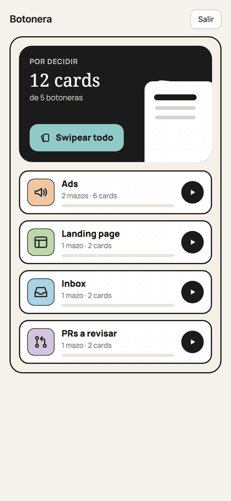

# Botonera

Un skill para tu agente de código que te junta lo que tenés que decidir y te lo deja como tarjetas para
swipear en el celu. Funciona con [Claude Code](https://claude.com/claude-code), Cursor, Codex o cualquier
agente que pueda correr un comando de Python ([tabla por agente](#con-qué-agente-se-usa)). El agente
investiga y recomienda; vos elegís con un dedo. La respuesta vuelve a la sesión que preguntó, y el agente
aplica solo lo que marcaste.

<p align="center"></p>

## Para quién es

Esta versión usa la terminal (la ventana de comandos) y dos cuentas gratis: **Supabase** guarda las
tarjetas y **Vercel** (o cualquier hosting estático) le da una dirección web a tu botonera. Si no querés
armar eso, la versión fácil es `/brain-decide` del mismo kit: ver el [README del kit](../README.md).

Glosario de una línea: la **clave pública** (en Supabase aparece como *publishable* o *anon*) es la
llave que identifica tu proyecto y viaja en la web; sola no lee nada. El **secreto** es otra cosa: se
genera en tu máquina y nunca sale de ahí.

## Qué trae cada tarjeta

- **Qué se decide** y el dato que lo decide, en dos líneas.
- **El agente recomienda** y por qué. El botón recomendado va siempre a la derecha, bordeado, sin marcar.
- **Botones que dicen la acción** («Cerrá el PR» / «Dejalo abierto»), o varias opciones cuando no es un sí o no.
- **«Editar»** para decir que sí con un cambio: los valores que propuso el agente salen cargados en campos
  (texto, texto largo, número, fecha u opción). Un comentario libre en cada tarjeta.
- **«+info»** para pedir que se explique mejor, sin decidir: elegís cómo (más contexto, dibujo corto, dibujo
  largo, escribirlo distinto, otro ejemplo) y el agente reescribe la tarjeta.
- **«Esto es regla»** en el detalle: el agente anota la decisión como regla permanente.
- **«Después»** para no decidir ahora; el agente no aplica nada y lo deja anotado.
- **Si no decidís**, qué pasó hasta acá y, plegado, el impacto de cada lado. Un **detalle** plegado para lo que no entra en el contexto.
- **Tarjetas de revisión** («mirá esto que hice»), con un solo botón: Revisado.
- **«Ya no aplica»** en una tarjeta que el agente reemplazó por otra.
- **Snooze** para dejar una botonera entera para más tarde (hasta 8 días). Duerme sin avisos y vuelve sola arriba con tus marcas.

La web tiene tres pestañas abajo, una vista por vez: **Sesiones** (qué hace cada sesión del agente y lo
que ya terminó hoy), **Decisiones** (las botoneras) y **Bloqueos** (lo que solo vos podés hacer y lo que
murió con error).

## Cómo funciona

```
tu agente  ──armar.py──▶ Supabase (tu proyecto) ◀──PIN── tu web en el celu
     ▲                        │                          (swipe, Enviar)
     └──── esperar.py ◀───────┘  la respuesta vuelve a la sesión
```

- `armar.py` valida el JSON de la tanda, arma la página y la publica. Si el servidor la rechaza o no hay red, sale con error.
- `esperar.py` espera en segundo plano y sale cuando decidiste. Con `--una-vez` consulta una sola vez, para agentes que no pueden esperar.
- `marcar.py` cierra el circuito; la web muestra qué se aplicó y qué no.
- `retomar.py` aplica una decisión aunque la sesión que preguntó ya no esté viva.
- `vuelo.py` cuenta qué hace la sesión; `obstaculo.py` publica lo que solo la persona puede hacer.
- La web no ejecuta nada. Ejecuta siempre la sesión de tu agente.

## Con qué agente se usa

| Agente | Se instala con | Dónde queda el skill | Cómo se invoca |
|---|---|---|---|
| Claude Code | `./install.sh --agente claude` (es el default) | `~/.claude/skills/botonera` | `/botonera` |
| Cursor | `./install.sh --agente cursor` | `~/.claude/skills/botonera` | `/botonera` |
| Codex | `./install.sh --agente codex` | `~/.agents/skills/botonera` | `$botonera` |
| Otro agente | `./install.sh --agente otro --skill-dir <carpeta>` | la carpeta donde tu agente lea sus instrucciones | pedile que siga el `SKILL.md` |
| Bot en un servidor | `./install.sh --solo-skill --skill-dir <carpeta>` | la que quieras | ver la receta de abajo |

El instalador reescribe la ruta del skill dentro del `SKILL.md` y de `rot.md` que instala, así que un
agente que no es Claude Code no ve rutas ajenas. Si tu agente no puede dejar un proceso corriendo mientras
vos decidís, el `SKILL.md` trae el flujo alternativo: publica, te dice la clave, vos escribís «listo» y
recién ahí consulta con `esperar.py <clave> --una-vez`.

Solo de Claude Code: el link «Abrir la conversación» de la web y el hook `entregar.py`.

**Receta para un bot en un servidor** (un agente sin tu secreto completo):

1. En tu máquina, con la instalación completa hecha: `python3 <skill>/secret-bot.py`. Escribe `env-bot` e imprime un SQL; ejecutalo en Supabase.
2. Llevá `env-bot` al servidor, a un archivo con permisos 600, fuera de cualquier repo.
3. En el bot: `export BM_ENV_FILE=<ruta de ese archivo>` (o las tres variables `SUPABASE_URL`, `SUPABASE_ANON_KEY`, `BM_SECRET`).
4. Cada sesión: `export BM_SESSION_ID=bot-<nombre>`. Sus claves empiezan con `bot-`.
5. Opcional, para achicar imágenes: `pip install pillow`.
6. Que el bot siga el `SKILL.md` instalado (`./install.sh --solo-skill` copia solo el skill: no genera secreto ni SQL).

El secreto de bot solo sirve para claves `bot-…`: no ve el resto de las tandas, ni el PIN, ni publica errores.
Para darlo de baja: `delete from public.bm_config where k = 'bot_secret_sha256';`.

## Instalación

Necesitás: Python 3.9+, `curl`, una cuenta gratis de [Supabase](https://supabase.com), un hosting estático
(abajo, [Vercel](https://vercel.com)) y el [CLI de Supabase](https://supabase.com/docs/guides/cli) para la
función de avisos. El instalador te avisa (sin cortar) si te falta el CLI de Supabase o el de Vercel y te
dice cómo instalarlos.

1. **Creá un proyecto en Supabase.** En *Project Settings → API* copiá la URL del proyecto (empieza con `https://`) y la
   clave pública (*publishable* o *anon*).

2. **Cloná y corré el instalador:**

   ```bash
   git clone https://github.com/brunogiel/agentic-second-brain.git
   cd agentic-second-brain/botonera
   ./install.sh --agente claude --url https://TU-PROYECTO.supabase.co --key TU_CLAVE_PUBLICA
   ```

   Prueba que la URL y la clave respondan (si no, te manda a *Project Settings → API*; `--sin-probar` saltea
   la prueba), copia el skill, guarda tu config en `~/.config/botonera/env` (permisos 600, con un secreto que se
   genera ahí y nunca se imprime), escribe `web/config.js` y deja `~/.config/botonera/instalar.sql`. Al final
   imprime la ruta completa del SQL y el comando para copiarlo al portapapeles.

3. **Pegá `instalar.sql`** en el *SQL Editor* de Supabase y ejecutalo. Crea las tablas, las funciones y los cron de avisos, y registra el hash de tu secreto.

4. **Subí la función de avisos** (desde la carpeta `botonera`):

   ```bash
   supabase login
   supabase functions deploy bm-avisar --project-ref TU-PROYECTO --no-verify-jwt
   ```

5. **Subí la web.** Cualquier hosting estático sirve si respeta los headers de `web/vercel.json`. Con Vercel:

   ```bash
   cd web && vercel deploy --prod
   ```

   Vercel te va a preguntar si querés crear el proyecto nuevo, cómo llamarlo y en qué carpeta está el código (la actual, `web`). No hace falta configurar nada más: la web es estática.

6. **Poné tu PIN** de 4 dígitos. Te lo pide con el teclado oculto; no se pasa por argumento.

   ```bash
   python3 ~/.claude/skills/botonera/pin.py poner
   ```

7. **En el celu**, abrí la URL de tu web, entrá con el PIN, agregala a la pantalla de inicio y tocá **Activar avisos**. En iPhone los avisos funcionan solo con la web agregada a la pantalla de inicio.

8. **En tu agente**, invocá `/botonera` (`$botonera` en Codex).

Podés repetir el instalador cuando quieras: reusa tu secreto y las migraciones se pueden repetir. Si venís de la 1.2.x, volvé a correrlo, pegá el `instalar.sql` nuevo y redesplegá la web.

### Opcional: red de seguridad (Claude Code)

Si la sesión se reinicia mientras esperaba, la respuesta queda guardada en la base. `entregar.py` la entrega igual como hook de Claude Code:

```bash
./install.sh --hook   # imprime el bloque para el archivo de ajustes de Claude Code
```

## Uso

- **`/botonera`**: las decisiones abiertas de esta conversación. **`/botonera <tema>`**: las de ese tema.
- Las categorías del home se editan en `categorias.json`, dentro de la carpeta del skill. El orden de la lista es el orden del home. `privada: true` hace que los avisos no nombren esa categoría.

Mantenimiento (reemplazá la ruta por la de tu agente si no es Claude Code):

```bash
python3 ~/.claude/skills/botonera/pendientes.py        # decidido y sin aplicar, y obstáculos resueltos
python3 ~/.claude/skills/botonera/colgadas.py          # tandas que no cerraron
python3 ~/.claude/skills/botonera/retomar.py <clave>   # el brief para aplicar una decisión sin la sesión viva
python3 ~/.claude/skills/botonera/pin.py estado        # PIN, bloqueo, sesiones y avisos
```

### Lo que solo vos podés hacer: obstáculos

Si el agente se frena por algo que solo vos podés hacer, lo publica en la pestaña **Bloqueos**, en «Te esperan a vos», con qué hacer y qué frena:

```bash
python3 ~/.claude/skills/botonera/obstaculo.py --titulo "Iniciá sesión en el panel" --link https://ejemplo.com \
    --frena "el reporte semanal" --por-que "pide un login tuyo" --retoma "corro el reporte" --de "reportes"
```

Cuando tocás «Listo», `pendientes.py` lo muestra como resuelto y la sesión retoma lo frenado.

### Fila «Con error»

Lo que murió sin avisar aparece en Bloqueos hasta que tocás **Visto**. Se publica con `errores.py` (`errores.py publicar '{"tipo":"tarea","origen_id":"mi-tarea","titulo":"Reporte","motivo":"Límite de uso"}'`).

## Seguridad

**El PIN es una puerta de comodidad, no un control fuerte.** Son 4 dígitos y la base guarda su hash, que con
tan pocas combinaciones se puede revertir si alguien lee tu base. Y quien entra con el PIN no solo ve
tarjetas: lo que escribe en un comentario o en un campo llega a tu agente como texto, y el agente puede ejecutar
una orden clara. El `SKILL.md` le pide confirmar en la conversación cualquier orden que borre, pague, mande algo
a un tercero o toque credenciales, pero la protección real es que nadie más tenga tu PIN.

**Qué ve cada llave:**

| Llave | Dónde vive | Qué puede |
|---|---|---|
| Clave pública | en la web (`config.js`) | nada por sí sola: solo intentar entrar con el PIN |
| PIN / sesión de la web | tu cabeza / el navegador del celu (vence a los 30 días) | ver tus tarjetas, decidir, snoozear |
| Secreto total | `~/.config/botonera/env` (600), en la base solo su hash | publicar, leer respuestas, poner el PIN, desbloquear |
| Secreto de bot | `env-bot` (600) | solo claves y sesiones `bot-…` |

La URL de tu web no es un secreto. Las tablas tienen RLS prendido y ninguna política: no se leen con la clave pública.

**Bloqueo del PIN.** Tras 10 fallos seguidos la entrada se bloquea 15 minutos. Cada tanda nueva de 10 fallos
duplica la espera (15, 30, 60 minutos… hasta un tope de 24 horas) y un ingreso correcto la pone en cero.
`pin.py desbloquear` la levanta ya, y `pin.py estado` dice si está bloqueada. Como la clave pública es visible,
cualquiera podría gastar tus intentos: por eso el bloqueo es temporal y no queda afuera hasta que vuelvas.

**Qué se manda a terceros:** a **Supabase**, todo el contenido de tus tarjetas y respuestas; a tu **hosting**
(Vercel), la web estática; a **jsdelivr** y **Google Fonts**, el pedido de código y tipografías cuando abrís la
web (ven tu IP); a Apple o Google, el **aviso push** (cifrado, con el título de la botonera salvo en las
categorías `privada`). Tus secretos no van a ninguno.

**Rotar el secreto:** borrá `~/.config/botonera/env`, corré `./install.sh` de nuevo (genera uno nuevo) y pegá el
`instalar.sql` nuevo en Supabase. **Cerrar todas las sesiones:** `pin.py poner` con un PIN nuevo. Nunca copies
`env` ni `env-bot` a un repo, un chat o un log.

**Cuánto cuesta.** Al momento de escribir esto, Supabase y Vercel tienen planes gratis que alcanzan para uso
personal; los límites cambian, mirá [Supabase](https://supabase.com/pricing) y [Vercel](https://vercel.com/pricing).
El gasto de tu agente (tokens) es aparte.

## Qué no trae

Esta versión no incluye: crear una tarea nueva desde el celu, dictado, inbox, ni lecturas. Sí conserva la fila
«Con error». Los avisos «Tarea hecha» tampoco.

## Probar en local

Con Docker y el CLI de Supabase, y los puertos 55321 en adelante libres:

```bash
supabase start                       # aplica las migraciones solas
python3 tests/prueba_local.py        # publica, entra con PIN, decide, recibe, marca y retoma
bash tests/prueba_instalador.sh      # el instalador y los scripts de config, sin red y con un HOME temporal
```

La web tiene su propia prueba, sin Supabase: `cd tests && npm install && npx playwright install chromium && node e2e-editar.js`.

## Desinstalar

1. Borrá la carpeta del skill (`~/.claude/skills/botonera`, `~/.agents/skills/botonera` o la que hayas elegido).
2. Borrá `~/.config/botonera/` (tu secreto, la config y los SQL).
3. Borrá el proyecto de Vercel y, si querés, el proyecto de Supabase (ahí viven tus tarjetas).
4. Quitá de los ajustes de tu agente el hook de `entregar.py`, si lo sumaste.

Para pausarla sin desinstalar: borrá `~/.config/botonera/env`. `armar.py` sigue armando el html local y avisa que no publicó.

## Licencia

MIT.
